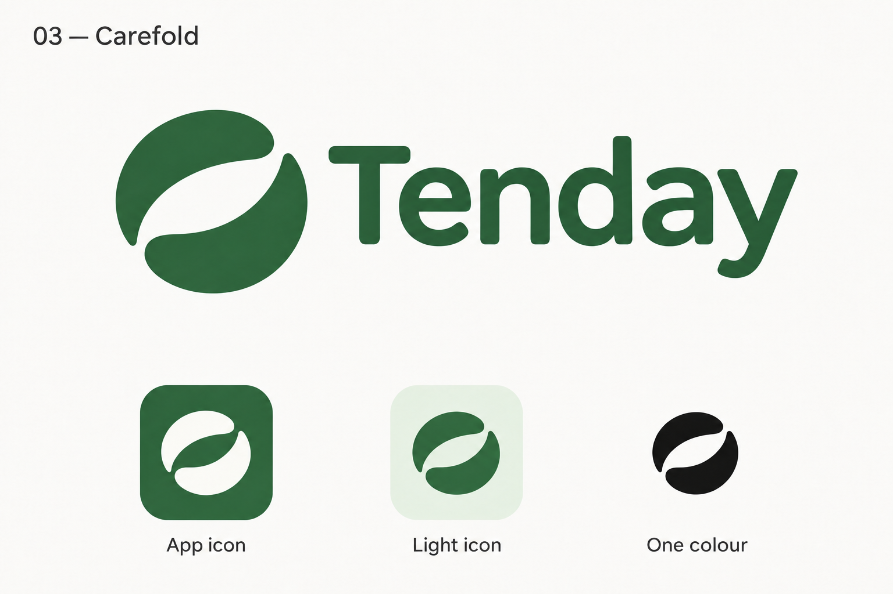

# Tenday

A calm personal health companion that turns meals, goals and health reports into useful daily actions.

**Status:** repository and design handoff prepared. App implementation begins in the dedicated build thread after one short round of essential decisions. This repository does not yet contain a runnable mobile app.



## Start here

- [Build handoff](docs/HANDOFF.md)
- [Implementation plan](plans/IMPLEMENTATION.md)
- [Product brief](docs/BRIEF.md)
- [Design system](docs/DESIGN_SYSTEM.md)
- [Decisions](docs/DECISIONS.md)
- [Conversation context](docs/CONTEXT.md)

## Product scope

1. Set a clear personal goal without a long signup funnel.
2. Log a meal by camera, voice or text; review estimates before saving.
3. Understand today's progress and get one contextual next step from a helpful assistant.
4. Upload a health report, check extracted readings and understand the terms.

Expo and React Native provide the mobile experience, Convex owns app data, and OpenRouter supplies AI capabilities. Firebase is optional and will be included only for a justified service such as identity.

## Workspace setup

Use pnpm; workspace packages will live under `apps/*` and `packages/*`. The root is intentionally light until app implementation starts.

```sh
pnpm verify:setup
```

Copy `.env.example` for a fresh local setup. `.env.local` is ignored. An authorised local OpenRouter key is already available on the original machine and configured on the separate Tenday Convex development deployment; never commit or expose it. See [setup details](docs/SETUP.md) for backend commands and remaining mobile/build setup.

## Brand

**Tenday** uses the **Carefold** emblem, forest green, sage and white. The approved board is the source of truth; the standalone emblem is a convenient workspace asset. Final vector assets should preserve the approved geometry. See [brand notes](assets/brand/README.md).

## Source brief

[Original assignment](https://docs.google.com/document/d/1aZeIitZOeb8W9lqR6rL36Mkspq65T2hpa0hr848rbNc/edit?tab=t.0). The repository brief preserves the requirements without publishing assignment-only placeholder names or submission contacts. The complete export is available locally to the implementation agent.
